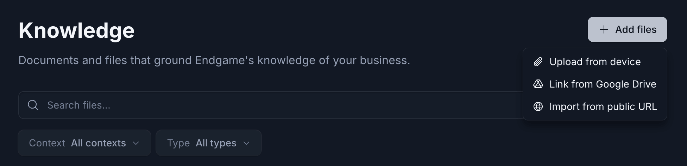
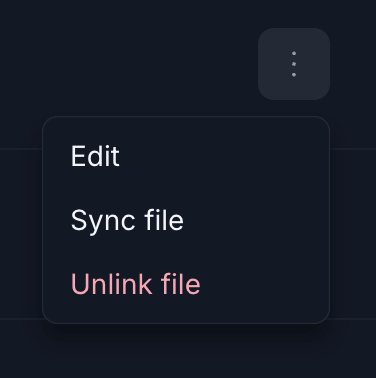
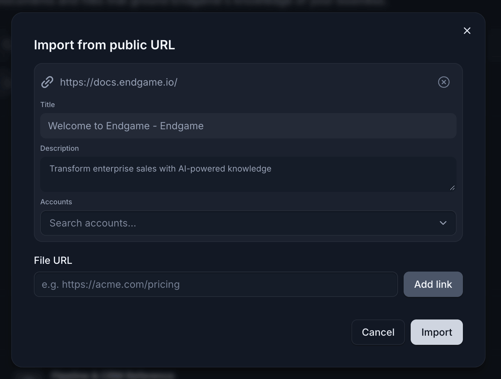

Individual users have the ability to upload documents to enhance the context provided to Endgame for accounts. Some types of documents that could be useful are account plans, meetings notes, or partnership decks. Anything that isn't already captured in the mediums Endgame already ingests can be added here.
To add files access the [**Knowledge**](https://app.endgame.io/settings/knowledge) view under **Settings** in the user menu.

<Frame caption="File Upload">
  
</Frame>

## Upload files from your device

Click **Add files** and select **Upload from device**.

Go through the flow to select up to 100 files at a time from your device. Before uploading, you can edit each file's title, add a description, and tag accounts. Click **Add files** to add more files, then click **Upload** to finish.

<Frame caption="File Upload Flow">
  
</Frame>

## Link files from Google Drive

Click **Add files** and select **Link from Google Drive**.

Go through the Google authentication process. Select all permissions requested (we only request [drive.file](https://developers.google.com/workspace/drive/api/guides/api-specific-auth) and [drive.readonly](https://developers.google.com/workspace/drive/api/guides/api-specific-auth)) for the best Endgame experience. Once authenticated, search for and select up to 100 files at a time to sync with Endgame, then click **Link**.

<Frame caption="Google File Select">
  
</Frame>

### Updating linked files

Your Google Drive files are automatically synced once per day, but you can trigger a manual sync anytime by opening the overflow menu (three dots) for the item and clicking **Sync file**.

<Frame caption="Sync Google Drive Files">
  
</Frame>

## Import files from a public URL

Click **Add files** and select **Import from public URL**.

Paste a link to a public document or webpage in the **File URL** field and click **Add link**. You can then edit the title and description for the URL and tag accounts. Continue to add additional URLs and click **Import** once completed. Your document will now be added to your list of Knowledge documents.

<Frame caption="Import from public URL">
  
</Frame>

## Remove files

Once your files are uploaded or linked, you can delete or unlink them anytime by opening the overflow menu for the item and clicking **Delete** or **Unlink file**. By deleting or unlinking the file you ensure that information associated with that file will no longer be present in new chat responses.

<Info>
  Application Admins have the ability to delete or unlink _any_ folder or file
  regardless of ownership.
</Info>

<Frame caption="Delete or Unlink Files">
  
</Frame>

### File sync frequency

| **Knowledge source** | **Frequency**                                        |
| -------------------- | ---------------------------------------------------- |
| Google Drive         | automatically 1/day - option for manual sync anytime |
| Public web URL       | must trigger manual sync                             |
| Personal upload      | must re-upload for new content                       |
