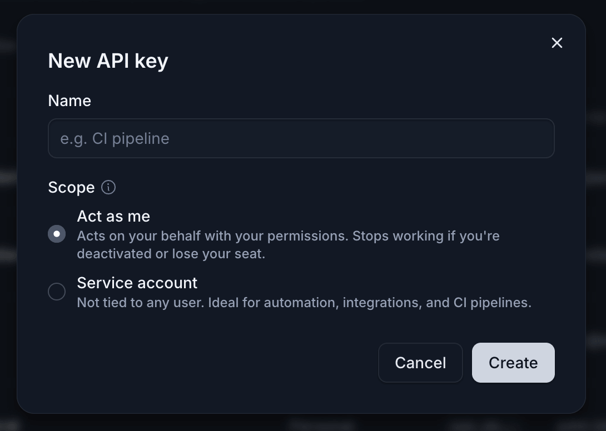
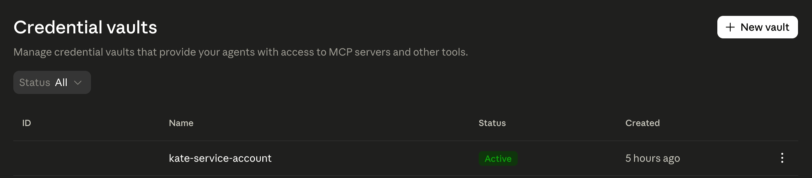
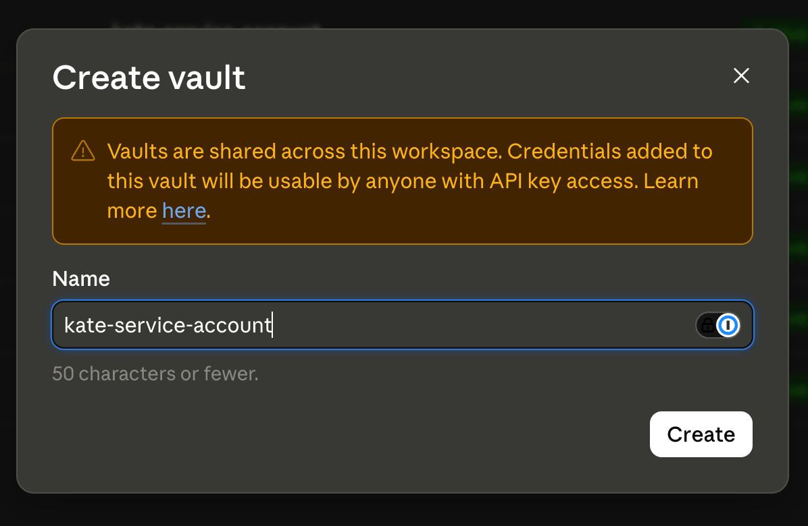
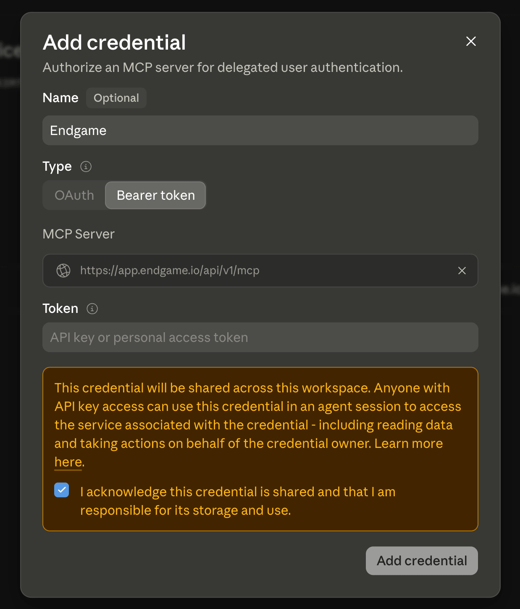
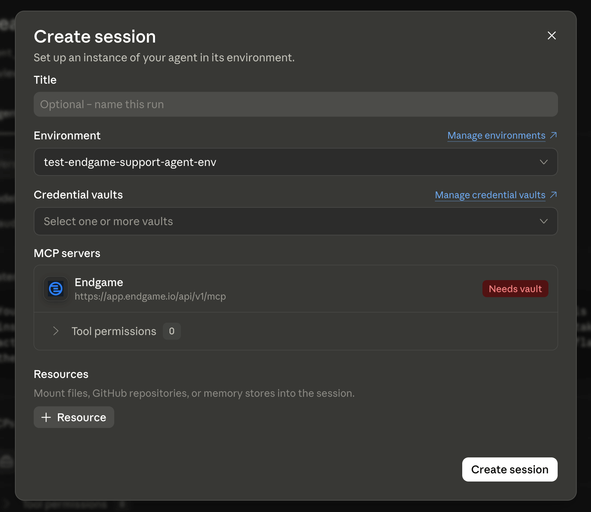

The Endgame MCP (Model Context Protocol) Server gives AI assistants like Claude or ChatGPT direct access to your organization's revenue intelligence -- CRM records, meeting transcripts, emails, Slack conversations, uploaded documents, and more. Once connected, your assistant can search interaction history, look up accounts, find stakeholders, query your data warehouse, and surface insights without leaving the conversation.

Think of it as giving your AI assistant a direct line to everything Endgame knows about your business.

## Getting Started

We recommend connecting Endgame through the **Endgame connector in Claude's connector directory**, **ChatGPT on the web or desktop**, or directly in a **Claude Code** or **Codex** terminal session. All options give your AI assistant direct access to all Endgame tools.

<Note>
  Want to call Endgame tools directly from your terminal or scripts, without an
  AI assistant? See the [Endgame CLI](/features/cli).
</Note>

### Connect via Claude

Endgame is available as a connector in Claude's connector directory. This is the recommended way to connect Endgame for Claude users, and gives Claude direct access to all Endgame tools.

<Steps>
  <Step title="Admin: Enable the Endgame connector for your organization">
    An admin needs to enable Endgame for the organization before anyone on the team can use it.

    1. In Claude, go to **Settings** → **Connectors**
    2. Search the connector directory for **Endgame**
    3. Enable the connector for your organization

    <Frame caption="Finding the Endgame connector in Claude's connector directory">
      
      
    </Frame>

  </Step>
  <Step title="Individual: Connect to Endgame">
    Once the admin has enabled the connector at the organization level, each team member can connect:

    1. Go to **Settings** → **Connectors** in Claude
    2. Find the Endgame connector and click **Connect**
    3. Follow the authentication prompts to sign in with your Endgame account

  </Step>
  <Step title="Start asking questions">
    Once connected, just ask Claude anything about your accounts, pipeline, meetings, or conversations. Claude will automatically use the right Endgame tools to find your answer.
  </Step>
</Steps>

<Note>
  Endgame periodically updates our MCP tools. You can ensure you have the latest
  tool set by going into your Endgame connector, opening the overflow menu, and
  clicking Refresh Tools List.
</Note>

### Connect via ChatGPT

Connect Endgame using the instructions for ChatGPT on the web or the desktop app. Sign in with your Endgame account when prompted.

<Tabs>
  <Tab title="Web">
    <Steps>
      <Step title="Enable Developer mode">
        In ChatGPT, open **Settings** → **Security and login** and turn on **Developer mode**.

        <Note>
          Developer mode requires an eligible ChatGPT plan and may be restricted by your workspace. If the setting is unavailable, ask your ChatGPT workspace admin about access.
        </Note>
      </Step>
      <Step title="Add Endgame">
        1. Open [Plugins](https://chatgpt.com/plugins) and select the **+** button.
        2. Enter **Endgame** as the name and a description, such as "Search accounts, meetings, and customer conversations in Endgame."
        3. Under **Connection**, enter the MCP server URL: `https://app.endgame.io/api/v1/mcp`.
        4. Choose **OAuth** authentication and create the connection.
        5. Complete the sign-in prompts with your Endgame account, then review the discovered tools.
      </Step>
      <Step title="Use Endgame in a conversation">
        Start a new conversation. Open the composer's **+** menu, choose **Developer mode**, and select **Endgame**.

        Try asking: "Use Endgame to summarize recent meetings for my accounts."
      </Step>
    </Steps>

    To get updated tools, open the Endgame connection in **Plugins**, select **Refresh**, and start a new conversation.

    See [OpenAI's Developer mode guide](https://developers.openai.com/api/docs/guides/developer-mode) for account eligibility and [MCP connection instructions](https://developers.openai.com/plugins/deploy/connect-chatgpt) for setup details.

  </Tab>
  <Tab title="Desktop app">
    <Steps>
      <Step title="Add the MCP server">
        1. In the ChatGPT desktop app, open **Settings** → **Plugins**.
        2. Open the **Add** menu and select **Add MCP server**.
        3. Enter **endgame** as the name. Under **Type**, select **Streamable HTTP**.
        4. Enter the **URL**: `https://app.endgame.io/api/v1/mcp`.
        5. Leave **Bearer token env var**, **Headers**, and **Headers from environment variables** blank, then click **Save**.

        This form has no OAuth selector. Sign in separately after saving the server.
      </Step>
      <Step title="Sign in to Endgame">
        1. Return to **Settings** → **Plugins** and select the **MCPs** tab.
        2. Find the server you just added under **Servers** and click **Authenticate** beside it.
        3. Complete the browser sign-in prompts with your Endgame account.
      </Step>
      <Step title="Check the connection and start asking questions">
        Start a new conversation and ask: "Use Endgame to summarize recent meetings for my accounts."
      </Step>
    </Steps>

    This configuration is shared with the Codex CLI and IDE extension on the same host. If you already configured Endgame there, check the server list before adding it again.

    See [OpenAI's desktop MCP instructions](https://learn.chatgpt.com/docs/extend/mcp) for more details.

  </Tab>
</Tabs>

<Note>
  If your ChatGPT workspace admin has already made Endgame available, open
  [Plugins](https://chatgpt.com/plugins), select **Endgame**, and connect with
  your own Endgame account. Ask your admin for access if it is missing.
</Note>

### Connect via Claude Code

Use the Claude Code CLI to add Endgame as a remote MCP server. This is a good option if you work in the terminal and want Endgame tools available in your Claude Code sessions.

<Steps>
  <Step title="Add the Endgame MCP server">
    In your terminal, run:

    ```bash
    claude mcp add --transport http endgame https://app.endgame.io/api/v1/mcp
    ```

    This uses the default `local` scope, which ties the server to the current project directory. If you want Endgame available across all your projects, use `--scope user` instead:

    ```bash
    claude mcp add --transport http endgame --scope user https://app.endgame.io/api/v1/mcp
    ```

    To share the config with your team, use `--scope project`. This writes the server to a `.mcp.json` file in your project root — commit that file to git and anyone who clones the repo will have it configured automatically:

    ```bash
    claude mcp add --transport http endgame --scope project https://app.endgame.io/api/v1/mcp
    ```

  </Step>
  <Step title="Authenticate with Endgame">
    Start a Claude Code session and verify the server is connected:

    ```bash
    claude
    ```

    In the session, run `/mcp`. This shows live connection status and confirms Endgame tools are loading. Select the Endgame server and follow the browser prompts to sign in with your Endgame account.

    <Note>
      You'll be prompted to authenticate the first time you connect. Claude Code will open a browser window to complete the OAuth flow with Endgame.
    </Note>

  </Step>
  <Step title="Start asking questions">
    Once connected, ask Claude anything about your accounts, pipeline, meetings, or conversations. Claude will automatically use the right Endgame tools to find your answer.
  </Step>
</Steps>

### Connect via Codex

Use the Codex CLI to add Endgame as a remote MCP server. This is a good option if you work in Codex terminal sessions and want Endgame tools available there.

<Steps>
  <Step title="Add the Endgame MCP server">
    In your terminal, run:

    ```bash
    codex mcp add endgame --url https://app.endgame.io/api/v1/mcp
    ```

    Codex detects OAuth support and may start the login flow automatically. If it does not, authenticate separately:

    ```bash
    codex mcp login endgame
    ```

    <Note>
      Running this command will open a browser window prompting you to sign in with your Endgame account. Complete the login there and Codex will store your credentials automatically.
    </Note>

    Verify the server was added:

    ```bash
    codex mcp list
    ```

  </Step>
  <Step title="Start a Codex session">
    Launch Codex in the directory where you want to work:

    ```bash
    codex
    ```

    Endgame tools are available once the MCP server is connected and authenticated.

  </Step>
  <Step title="Start asking questions">
    Once connected, ask Codex anything about your accounts, pipeline, meetings, or conversations. Codex will automatically use the right Endgame tools to find your answer.
  </Step>
</Steps>

### Connect via Claude Managed Agents (Service Accounts)

Use a service account API key to connect Endgame to Claude Managed Agents (CMA). Service accounts are user-agnostic and scoped to your organization, making them the right choice for automated or shared agent workflows.

<Steps>
  <Step title="Create a service account API key in Endgame">
    1. Go to [https://app.endgame.io/settings/api-keys](https://app.endgame.io/settings/api-keys)
    2. Click **New API key**
    3. Name your key and select the **Service account** option
    4. Click **Create** and copy the key immediately — you won't be able to view it again

    <Note>
      Only Endgame Admins can create api keys. The number of service keys you are allowed to create for your organization may be limited.
    </Note>

    <Frame caption="Creating a service account API key in Endgame">
      
    </Frame>

  </Step>
  <Step title="Create a credential vault in CMA">
    1. In Claude Managed Agents, go to **Credential Vaults** in the side navigation
    2. Click **\+ New Vault**

    <Frame caption="Adding a new vault in Claude Managed Agents">
      
    </Frame>

    3. Enter a name for your vault and click **Create**

    <Frame caption="Creating a vault in Claude Managed Agents">
      
    </Frame>

  </Step>
  <Step title="Add your Endgame API key as a credential">
    1. Inside your new vault, click **Add Credential**
    2. Select **Bearer Token** as the credential type
    3. Paste the API key you created in Endgame
    4. Set the custom connector URL to: `https://app.endgame.io/api/v1/mcp`
    5. Save the credential

    <Frame caption="Adding the Endgame API key as a credential">
      
    </Frame>

  </Step>
  <Step title="Use the vault in an agent session">
    When starting a session with an agent that requires the Endgame MCP, you will be prompted to provide credentials. Select the vault you created to authenticate the session.

    <Frame caption="Selecting a credential vault when starting a CMA session">
      
    </Frame>

  </Step>
</Steps>

<Note>
  For information on setting and accessing vault credentials programmatically,
  refer to the [Claude Managed Agents vaults
  documentation](https://platform.claude.com/docs/en/managed-agents/vaults).
</Note>

## How to Use It

Once connected, simply ask your AI assistant questions about your business. You don't need to use any special syntax -- your assistant will automatically select the right Endgame tools based on your question.

For complex analyses, your assistant can chain multiple tools together -- for example, finding an account, pulling its recent interactions, and searching the evidence behind them to build a complete picture.

<CardGroup cols={2}>
  <Card title="Account intelligence" icon="building">
    "What accounts does my team own, and when was the last time we interacted with each one?"
  </Card>

<Card title="Conversation insights" icon="message-square">
  "What did customers bring up as pain points or risks across our last 20 sales
  calls?"
</Card>

<Card title="Public intelligence" icon="newspaper">
  "What did Salesforce's CFO say about their AI strategy on the most recent
  earnings call?"
</Card>

<Card title="Pipeline analytics" icon="chart-line">
  "Show me all open opportunities over \$500K that haven't had any activity in
  the last 45 days."
</Card>

<Card title="Internal communications" icon="hash">
  "What are we saying internally on Slack about the upcoming renewal with Acme
  Corp?"
</Card>

  <Card title="People research" icon="user-search">
    "Who are the key executives at this account, and can anyone on our team make an introduction?"
  </Card>
</CardGroup>

## Available Tools

When connected, the following tools are available. Your AI assistant selects the right tool automatically based on your question.

| Tool           | Description                                                                                                                                                                                                                                                                                  |
| -------------- | -------------------------------------------------------------------------------------------------------------------------------------------------------------------------------------------------------------------------------------------------------------------------------------------- |
| `find`         | Resolve something your question names -- an account, person, opportunity, meeting, email, or document -- to its record in your organization's context graph. Accepts a name, email address, Salesforce record ID, or graph ID.                                                              |
| `query`        | Walk, list, rank, and count across the context graph -- the meetings on an account, every open opportunity, contacts per company, or the calls, emails, and documents that discuss a topic. Counts and totals are computed server-side.                                                      |
| `read`         | Load the full records for up to 20 entities at once, optionally with the facts and evidence behind them, or search what was said and written inside specific calls, emails, or accounts. Also loads your profile, preferences, organization rules, skills, and digests.                      |
| `digest`       | Create, change, pause, resume, or delete a recurring digest delivered daily, on weekdays, weekly, monthly, or quarterly. Use `read` to list or open existing digests.                                                                                                                        |
| `tell_endgame` | Correct or add to the context graph, and send feedback to the Endgame team. Use it when something in Endgame is wrong, outdated, or missing -- a company's industry, someone's employer, a stakeholder on a deal, an entity Endgame doesn't know yet -- or to file a bug or feature request. |

<Note>
  The `digest` tool requires a signed-in user, so it isn't available to
  service account connections.
</Note>

## Rate Limits

Rate limits are configured per organization and may vary depending on your plan. If you encounter rate limit errors, contact your Endgame administrator to review your organization's current limits.

## Important Notes

- **Response time**: Complex queries -- especially org-wide searches and aggregations across the context graph -- can take up to a few minutes to complete.
- **Data access**: Results are scoped to the data your organization has connected to Endgame (CRM, transcripts, Slack, etc.).

## Troubleshooting

**Claude doesn't seem to have access to Endgame tools?**

- In Claude, go to **Settings** → **Extensions** (under Desktop App) and confirm the Endgame connector is toggled on
- Check that tool permissions are set to **Always Allow** for all Endgame tools

**Getting authentication errors?**

- Your session may have expired -- try reconnecting the connector

**Hitting rate limits?**

- You've exceeded your organization's request limit
- Limits reset daily. Contact your administrator if you need an adjustment

## Need Help?

For issues or questions about the Endgame MCP Server, contact your Endgame administrator or reach out to [support@endgame.io](mailto:support@endgame.io).
