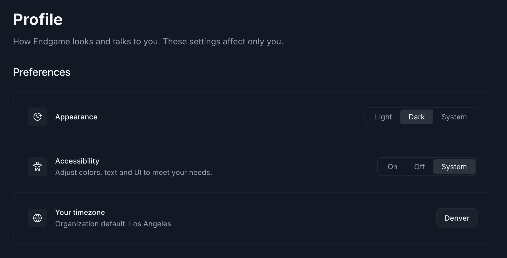
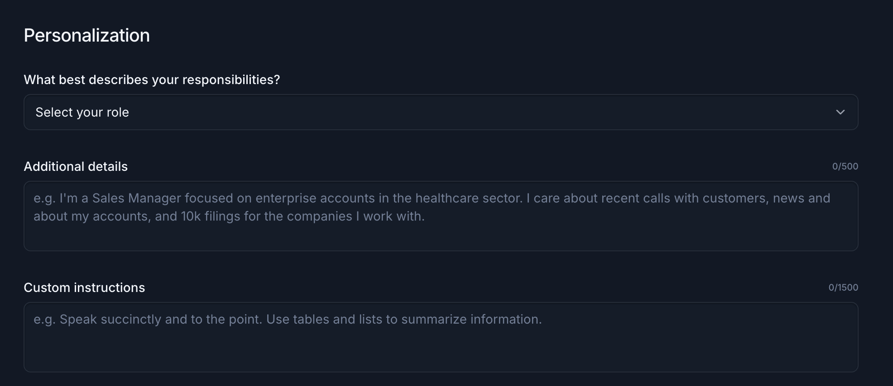
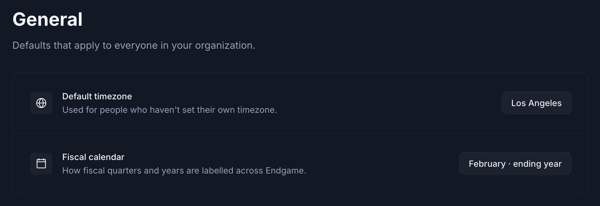

## User configuration

Users can customize how Endgame looks and responds to them from the Profile section of the [user settings view](https://app.endgame.io/settings). These settings only affect you, not the rest of your organization.

## Preferences

The Preferences section controls how Endgame displays for you:

- **Appearance** - Choose Light, Dark, or System to match your operating system's theme.
- **Accessibility** - Adjust colors, text, and UI to meet your needs. Choose On, Off, or System to follow your operating system's accessibility settings.
- **Your timezone** - Set the timezone Endgame uses for you. If you don't set one, Endgame uses your organization's default timezone, which is shown below the setting.

<Frame caption="Preferences">
  
</Frame>

## Personalization

The Personalization section lets you tell Endgame about your position and your chat preferences so it can deliver more relevant responses.

Under **What best describes your responsibilities?**, select the role that best matches your work. Then use the **Additional details** field (up to 500 characters) to include details about your responsibilities, level within your organization's hierarchy, types of activities you engage in, and any other data relevant to your work. This context enables Endgame to provide more accurate and meaningful responses tailored to your specific needs. For example:

- "I'm a Sales Manager overseeing a team of 8 account executives in the Mid-Market segment. I'm responsible for pipeline management, forecasting, and coaching my team on deal strategy. I frequently work with opportunity data, account health metrics, and sales performance reports."
- "I'm a Customer Success Director managing enterprise accounts with ARR over $100K. My focus areas include renewal strategy, expansion opportunities, and customer health monitoring. I regularly analyze usage data, support tickets, and engagement metrics to identify at-risk accounts and growth opportunities."

The **Custom instructions** field (up to 1,500 characters) offers additional flexibility, allowing you to specify preferences such as response formatting, tone, or any other guidelines that will enhance your experience. For example:

- "I prefer concise, direct responses without excessive explanations."
- "I work in sales and need help with objection handling and deal strategy."
- "Focus on actionable advice I can implement immediately."
- "Use conversational language and avoid overly technical jargon."
- "Provide responses with specific examples whenever possible."

<Frame caption="Personalization">
  
</Frame>

## Organization settings

<Note>
  Only admins have access to these settings. Changes apply to everyone in your
  organization.
</Note>

The General section of settings holds defaults that apply to everyone in your organization:

- **Default timezone** - The timezone Endgame uses for anyone who hasn't set their own in [Preferences](#preferences).
- **Fiscal calendar** - Controls how fiscal quarters and years are labeled across Endgame. Set the month your fiscal year starts and whether the fiscal year is named for the calendar year it starts or ends in. For example, "February · ending year" means the fiscal year begins in February and is named for the year it ends in.

<Frame caption="Organization settings">
  
</Frame>
