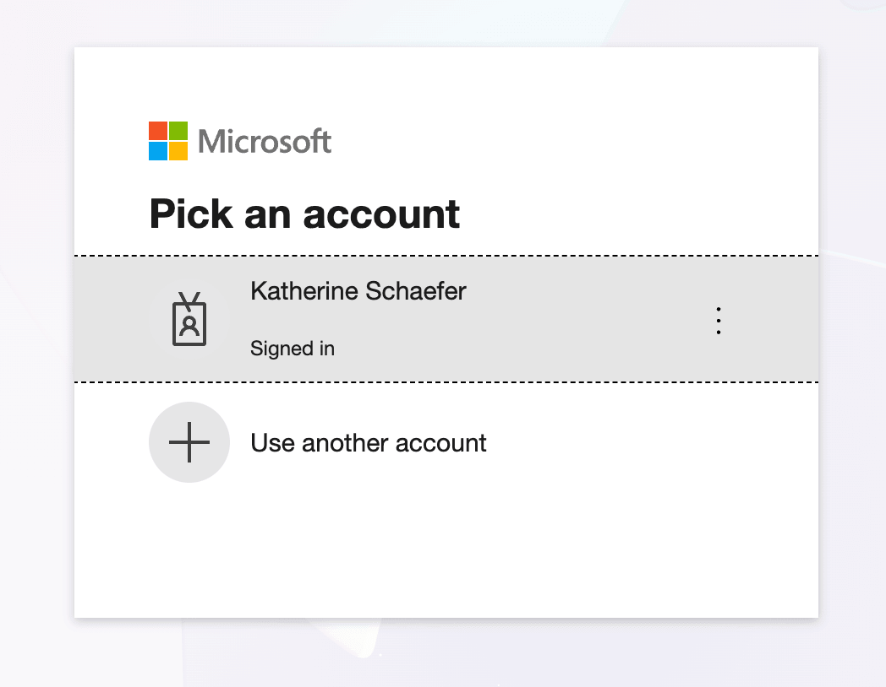
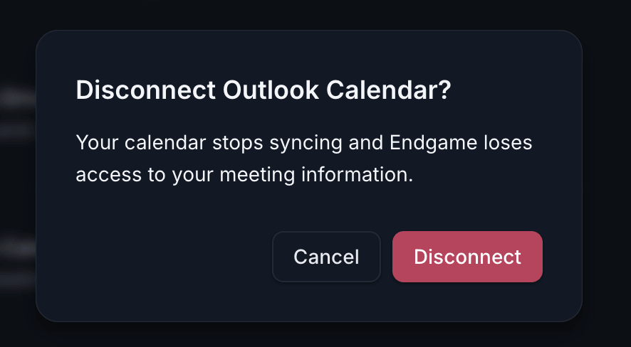

<Note>
  Outlook Calendar is a personal connection. Each person connects their own Microsoft account in [**Settings** > **You** > **Connections**](https://app.endgame.io/settings/connections), and it only affects them. If you don't see Outlook Calendar there, your organization has turned off Microsoft connections. Contact [support@endgame.io](mailto:support@endgame.io) to turn it on.
</Note>

Individual users can sync their Outlook calendars to provide more accurate and comprehensive meeting data for use in chat responses. This can be done in [**Settings** > **You** > **Connections**](https://app.endgame.io/settings/connections).

<Frame caption="Microsoft Outlook Calendar connection">
  
</Frame>

After clicking **Connect**, users will go through the Microsoft authentication flow to grant Endgame permission to ingest their calendar data.

<Frame caption="Microsoft account selection">
  
</Frame>

Users can disconnect their Outlook calendar anytime by clicking **Disconnect** next to **Outlook Calendar**. A confirmation modal will appear. Click **Disconnect** to confirm. Your calendar stops syncing and Endgame will no longer have access to future meeting data. Disconnecting doesn't delete meeting data Endgame has already synced.

<Frame caption="Disconnect Outlook Calendar confirmation">
  
</Frame>
