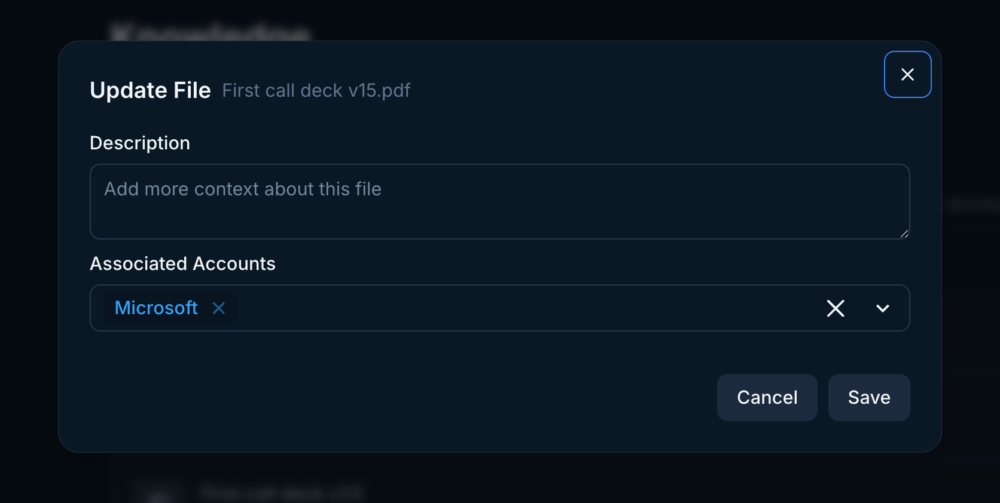
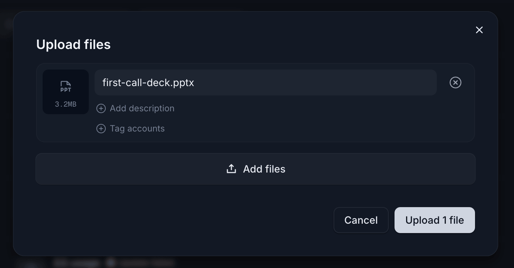
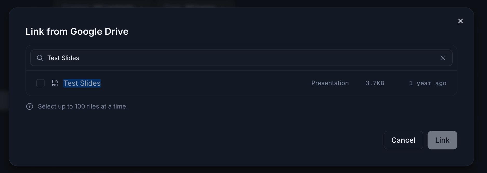

Admin users can upload knowledge documents to enhance the context provided to Endgame for all chat responses. This unified view displays all knowledge content across your entire organization, including both organization-level and account-specific documents. Organization-level content is particularly useful for materials like playbooks, case studies, sales decks, or any other resources that aren't already captured through Endgame's existing integrations. Account-specific documents can also be uploaded and managed here, ensuring comprehensive knowledge management in a single location. Use the **Context** and **Type** filters in addition to search to find specific documents.

<Frame caption="File Upload">
  
</Frame>

When uploading content through the Admin knowledge view, the system automatically categorizes documents as organization or account content and intelligently detects account associations. This can take a few minutes to run, the more files uploaded, the longer the associations take. Admins have the ability to edit account associations manually.

<Info>
  Adding an account association to an organization-level document converts it to
  an account specific document.
</Info>

<Frame caption="Edit knowledge document">
  
</Frame>

## Upload files from your device

Navigate to the [Knowledge](https://app.endgame.io/settings/knowledge) section in settings. Click **Add files** and select **Upload from device**.

<Frame caption="File Upload">
  
</Frame>

Go through the flow to select up to 10 files at a time from your device. Before uploading, you can edit each file's title, add a description, and tag accounts. Click **Add files** to add more files, then click **Upload** to finish.

<Frame caption="File Upload Flow">
  
</Frame>

### Link files from Google Drive

Navigate to the [Knowledge](https://app.endgame.io/settings/knowledge) section in settings. Click **Add files** and select **Link from Google Drive**.

<Frame caption="File Upload">
  
</Frame>

Go through the Google authentication process. Select all permissions requested for the best Endgame experience. Once authenticated, search for and select up to 100 files at a time to sync with Endgame, then click **Link**.

<Frame caption="Google File Select">
  
</Frame>

### Import files from a public URL

Navigate to the [Knowledge](https://app.endgame.io/settings/knowledge) section in settings. Click **Add files** and select **Import from public URL**.

<Frame caption="File Upload">
  
</Frame>

Paste a link to a public document or webpage in the **File URL** field and click **Add link**. You can then edit the title and description for the URL and tag accounts. Continue to add additional URLs and click **Import** once completed. Your document will now be added to your list of Knowledge documents.

<Frame caption="Import from public URL">
  
</Frame>

### File sync frequency

| **Knowledge source** | **Frequency**                                          |
| -------------------- | ------------------------------------------------------ |
| Google Drive         | automatically 1/day - option for manual sync anytime   |
| Confluence           | automatically 1/hour - option for manual sync anytime  |
| Public web URL       | must trigger manual sync                               |
| Personal upload      | must re-upload for new content                         |
